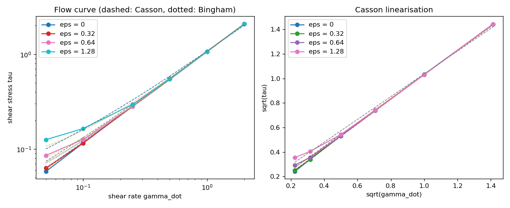
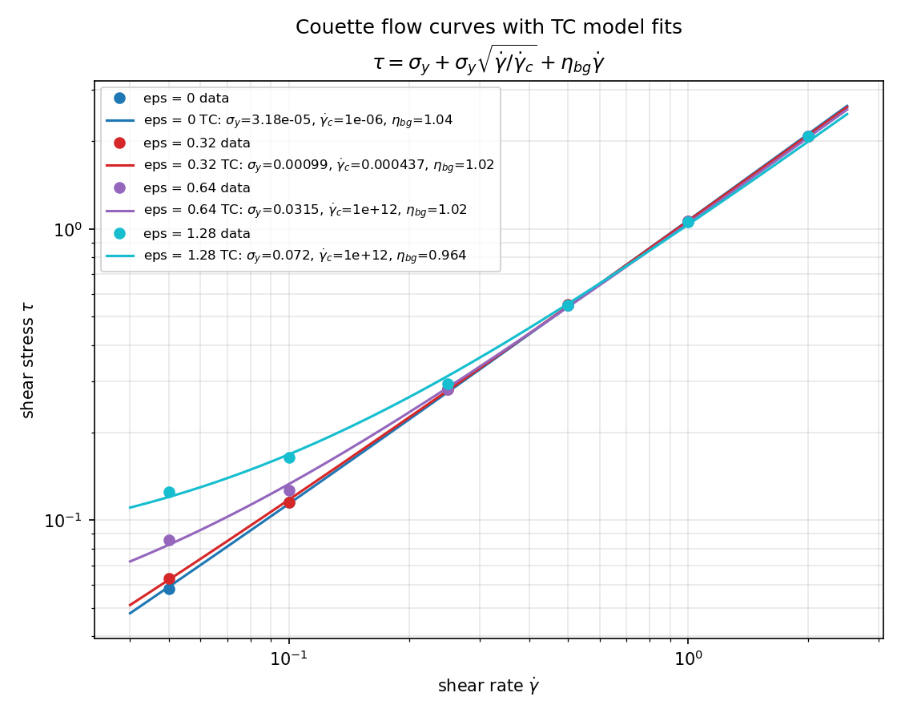
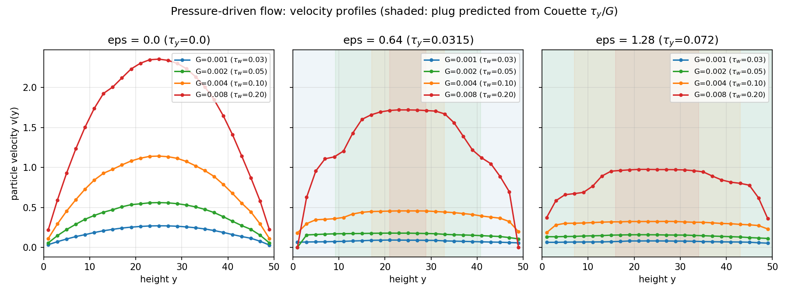
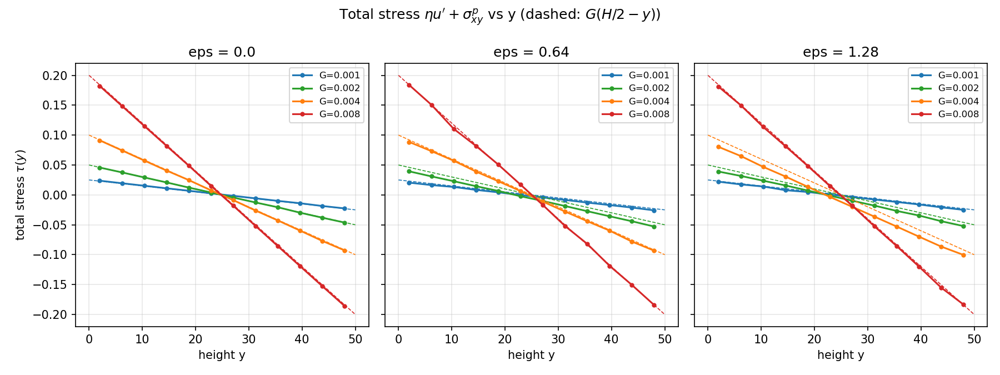

# Bloodflow

A toy model for a simple question: **can red blood cell aggregation turn
Poiseuille flow into plug flow, and does that cut the long residence time
of cells near the vessel wall?**

Rigid disks flow in a 2D channel under an imposed Poiseuille profile.
Turn on a short-range attraction between the disks and they aggregate;
the aggregates move as a plug, so slow near-wall particles get carried
along instead of lingering. The strength of the effect is measured through
the distribution of per-particle transit times.

The same particles can also be sheared in planar Couette flow, where the
shear stress is a genuine response and the flow curve τ(γ̇) can be
measured — and driven by a pressure gradient instead of an imposed
profile, so the velocity profile (and the plug in it) emerges from the
material. See [Flow curves](#flow-curves-couette-rheometry) and
[Pressure-driven flow](#pressure-driven-flow-the-profile-emerges) below.

## Model

Overdamped Brownian dynamics of N disks of radius `a` in a channel of
width `H` (walls at y = 0 and y = H), periodic in x with period `L`:

```
dr_i/dt = U(y_i) x-hat + (1/zeta) * sum_j F_ij + thermal noise
zeta = 6*pi*eta*a
```

The 3D Stokes drag for spheres constrained to a plane avoids the 2D
Stokes paradox. The imposed Poiseuille profile is

```
U(y) = 4*Umax*(y/H)*(1 - y/H),   Umax = dP*H^2/(8*eta*L)
```

so the pressure drop enters through `Umax` (or equivalently the wall
shear rate `gamma_w = 4*Umax/H`).

The Couette mode (`bloodflow/couette.py`) replaces the parabola with a
linear field `U(y) = gamma_dot*(y - H/2)` and measures the shear stress
the particles exert in response, from the pair virial and from the
method of planes. The pressure-driven mode (`bloodflow/pressure.py`)
removes the imposed profile altogether: it imposes the pressure gradient
`G` and solves the 1D Stokes equation for the solvent velocity each step,
with the particle drag as a source term, so the profile emerges.

Forces:

- **WCA repulsion** (repulsive Lennard-Jones, cutoff at 2^(1/6)*sigma,
  sigma = 2a) between particles, and the same form against both walls.
- **Morse attraction**,
  `U(r) = eps*(exp(-2*kappa*(r-2a)) - 2*exp(-kappa*(r-2a)))`,
  with tunable depth `eps` and inverse range `kappa`. Minimum `-eps` at
  contact. (`eps = 0` = no aggregation.)
- **Thermal noise** (Euler-Maruyama, diffusion coefficient `D = kT/zeta`);
  default `kT = 0` for deterministic runs.

Integration is explicit Euler with a linked-cell neighbour list (padded
grid, vectorised over cell pairs), so a few thousand particles run fast.

## Parameters and dimensionless groups

| Parameter | Meaning |
|---|---|
| `a`, `H`, `L` | particle radius, channel width, channel period |
| `eta`, `Umax` | plasma viscosity, centreline velocity (from pressure drop) |
| `eps`, `kappa` | attraction depth, inverse attraction range |
| `N` | particle number (sets the area fraction) |
| `kT`, `dt`, `seed` | thermal energy, time step, RNG seed |

| Group | Meaning |
|---|---|
| `a/H` | confinement: large = vessel barely bigger than a cell (mouse-like), small = artery much bigger than a cell |
| `phi = N*pi*a^2/(L*H)` | area fraction (2D hematocrit) |
| `Mason = (eps*kappa)/(eta*gamma_w*a^2)` | attraction force vs hydrodynamic force; >> 1 means aggregates survive the shear |
| `Pe` | Peclet number (advection vs diffusion); huge for real RBCs, so noise is kept tiny |

## Install

```bash
pip install numpy
pip install -e .        # or just run from this directory
```

Only `numpy` is required at runtime.

## Run the example sweep

```bash
python examples/sweep_attraction.py
```

Runs a short sweep over attraction strength at fixed flow and prints the
transit-time summary per `eps`. Expected output (takes ~30 s):

```
channel H=16.0, L=40.0, a=1.0 (a/H=0.062), area fraction phi=0.29, Umax=1.0, wall shear=0.250, dt=0.02
  eps   Mason    mean  median     p95  frac>3x  compl  wall_t  clust  in_cl
  0.0     0.0    66.6    48.4   137.9    0.000   1.00    34.8   1.50   0.45
  0.5     4.0    60.1    47.4   123.2    0.000   1.00    19.6   6.00   0.93
  2.0    16.0    52.2    49.5    75.0    0.000   1.00     4.4  15.00   0.98
```

Reading: as attraction grows, the transit-time tail shrinks (p95 138 → 75),
the mean near-wall residence time collapses (35 → 4), and clusters grow
(mean size 1.5 → 15). `frac>3x` is the fraction of completed transits
slower than 3x the mean; `compl` is the fraction of particles that
completed a transit (the rest are censored at the end of the run).

## Flow curves: Couette rheometry

In the Poiseuille setup the velocity profile is imposed, so the material
never gets to decide whether to flow — the defining feature of a
yield-stress fluid cannot appear, and there is no stress on the other side
of the equation to measure a flow curve against. The Couette mode fixes
that: the shear rate is imposed (a linear velocity field) and the shear
stress is a genuine response of the particles, measured two ways that must
agree in steady state — the pair virial σ_xy and the method-of-planes
stress τ(y).

```bash
python examples/flow_curve.py --plot flow-curve.png   # ~10 min at N=397
python examples/tc_fit.py --plot tc-fit-loglog.png    # TC model fits
```



The flow curve works: with no attraction the material is Newtonian
(τ ∝ γ̇ through the origin); with attraction it gains a yield stress that
grows with eps. But the shape is **Bingham, not Casson**: the particle
stress is roughly rate-independent at low rates (a constant offset), so the
Bingham fit beats Casson (R² 0.9997–0.9999 vs 0.9961–0.9999) and the Casson
intercept underestimates the yield ~5×. The yield shows only at low rates —
above γ̇ ≈ 0.5 the stress is identical with or without attraction (the
aggregates are broken, Ma ≈ 5); eps = 0.32 shows essentially no yield (the
clusters never percolate; eps = 1.28 percolates, mean cluster 13.7 at
γ̇ = 0.05). High-rate viscosity ≈ solvent (η_p ≈ 1.01–1.03, all eps).

Fitting the TC model (Caggioni, Trappe & Spicer 2020, J. Rheol. 64(2)
413–422), τ = σ_y + σ_y√(γ̇/γ̇_c) + η_bg·γ̇, with relative residuals (so
every decade counts equally), drives γ̇_c to the top of its range — the
√γ̇ term switches off and TC collapses exactly onto Bingham:



| eps | σ_y (TC / Bingham) | γ̇_c | η_bg | Casson τ_y |
|---|---|---|---|---|
| 0 | ~0 | — | 1.04 | 0.0002 |
| 0.32 | 0.001 | 4×10⁻⁴ | 1.02 | 0.0006 |
| 0.64 | 0.032 | →∞ | 1.02 | 0.0045 |
| 1.28 | 0.072 | →∞ | 0.96 | 0.019 |

The toy rejects the √γ̇ component that distinguishes TC from Bingham: its
aggregates either hold (a rate-independent offset) or break, with no
gradual fluidisation in between. Note on the numbers: the yields above
come from relative-residual fits, which respect the low-rate points where
the yield lives. Ordinary least-squares fits (the values
`examples/flow_curve.py` prints) weight the high-rate points and
underestimate the intercept (Bingham τ_y 0.030 / 0.057 for eps 0.64 /
1.28) — the pressure-driven plug below sides with the relative-residual
values.

## Pressure-driven flow: the profile emerges

The pressure-driven mode imposes a pressure gradient `G` and lets the
velocity profile emerge. Each step it solves the 1D Stokes equation for
the solvent velocity u(y) — pressure gradient driving it, no-slip at the
walls, the drag from the particles as a source term — and advects the
particles with the solved u(y). No body force acts on the particles
themselves (they are neutrally buoyant; the pressure acts on the fluid).

```bash
python examples/pressure_flow.py   # ~35 min at N=397, 12 points
```



With no attraction the profile is a clean parabola (quadratic fit
R² = 0.9987; particle and solvent Umax agree to <1%; η_eff 1.16 → 1.06,
shear-thinning from the WCA collisions), and the transit statistics match
the imposed-profile runs at the same Umax. With attraction the plug
emerges in the middle — and its width is exactly what the Couette yield
stress predicts:

| eps | G | τ_wall | plug half-width (stress) | τ_y / G |
|---|---|---|---|---|
| 0.64 | 0.002 | 0.050 | 15.8 | 15.8 |
| 0.64 | 0.004 | 0.100 | 7.9 | 7.9 |
| 0.64 | 0.008 | 0.200 | 3.9 | 3.9 |
| 1.28 | 0.004 | 0.100 | 18.0 | 18.0 |
| 1.28 | 0.008 | 0.200 | 9.0 | 9.0 |

(Two points are left out: at G = 0.001–0.002 for eps = 1.28 the predicted
plug is wider than the channel, so it spans it.) The total stress
ηu′ + σ^p_xy is linear in y with slope −G at every point (R² ≥ 0.999),
which is the momentum balance the whole construction has to satisfy:



Two honest caveats. The plug is rounded, not flat-with-a-kink: the
velocity-based width depends on the threshold, while the stress-based
width is robust — τ_y/G is an upper bound on the flat region, matched
exactly by the stress measurement. And below the yield (τ_wall < τ_y) the
profile creeps rather than stopping outright (centre velocity ~30% of the
Newtonian value at the same G): with frictionless walls there is nothing
to hold the plug still, so a true no-flow state would need a wall-friction
term.

## Videos

All five video scripts have a rendered example below (the notebook versions, as produced by [`examples/videos.ipynb`](examples/videos.ipynb) — see the trims there; the full-scale scripts give longer runs):

- [Poiseuille vs plug](videos/bloodflow-poiseuille-vs-plug.mp4) — side by side, no attraction vs strong attraction, 8 s at 25 fps.
- [Constriction](videos/bloodflow-constriction.mp4) — same setup through a 10-wide throat, 8 s at 25 fps.
- [Pulsatile flow](videos/bloodflow-pulsatile.mp4) — sinusoidal pressure drop, no reversal: 12 beats at the same mean flow as the steady run, with a waveform strip marking beat phase and Mason number. The plug breathes but survives (phase-averaged cluster fraction ~0.92 at systole vs ~0.97 at diastole).
- [Pulsatile flow, notebook version](videos/bloodflow-pulsatile-notebook.mp4) — 4 beats / 8 s, as produced by `examples/videos.ipynb` (cluster fraction 0.90 at systole vs 0.91 at diastole).
- [Attraction ladder](videos/stacked-attraction-video.mp4) — four strengths stacked (eps 0, 0.32, 0.64, 1.28), 4 s at 25 fps.
- [Branching network](videos/bloodflow-network.mp4) — 1→2→4→8→4→2→1 ladder, no attraction vs strong attraction, 4 s at 25 fps.

Notebook versions of all five video scripts live in [`examples/videos.ipynb`](examples/videos.ipynb): Poiseuille vs plug, constriction, pulsatile, the stacked attraction ladder, and the branching network. Each section renders its frames and encodes the MP4 in the browser (see below); the runs are trimmed relative to the scripts — fewer seconds, steps, or beats — so they finish in a few minutes in the browser, and each section says exactly how.

## Export an MP4 in the browser

The notebooks can encode their own MP4s without leaving the browser.
JupyterLite ships no ffmpeg binary, so the export cells in `demo.ipynb`
and the `export_mp4` helper in `examples/videos.ipynb` use
[ffmpeg.wasm](https://ffmpegwasm.netlify.app/) — FFmpeg compiled to
WebAssembly — vendored in this repo under `vendor/ffmpeg/` and served
from the same site as the notebook (no CDN; the CDN version failed live
because the browser blocks the cross-origin worker file), driven from
Python through Pyodide's JavaScript bridge. The first run downloads
~31 MB of WASM; the browser caches it afterwards, and in
`examples/videos.ipynb` the loaded encoder is reused for all five
videos. The single-threaded core is used on purpose: GitHub Pages sends
no cross-origin-isolation headers, so the multi-threaded core cannot
load here.

In `demo.ipynb`, run the two cells (render frames, then encode): they
render the eps = 2 run as 90 PNG frames (3 s at 30 fps), encode them
with libx264 (`-pix_fmt yuv420p`), and save `bloodflow-export.mp4`
next to the notebook — it appears in the file browser (right-click →
Download) and plays inline. The temporary frames are deleted from
ffmpeg's in-memory filesystem after encoding; only the intermediates
are cleared, the simulation data stays in the notebook.

Two things the export depends on, found the hard way:
- The core must be the **ESM build** (`@ffmpeg/core` `dist/esm`).
  The wrapper spawns a *module* worker, which has no `importScripts`,
  so it falls back to importing the core as an ES module — and the UMD
  build exports nothing, so `load()` hangs forever with no error.
- Every Python value handed to ffmpeg's JS methods must cross with
  `pyodide.ffi.to_js` first. Otherwise it arrives as a PyProxy, and
  `postMessage` cannot clone a PyProxy into ffmpeg's worker
  (`DataCloneError`). That covers the PNG bytes in `writeFile` and the
  argument list in `exec`.

## Run the validation test

```bash
python tests/test_poiseuille.py   # plain python, no pytest needed
python -m pytest tests/           # also pytest-compatible
```

With attraction off and no noise, every particle is advected at exactly
the Poiseuille velocity of its height, so its transit time must equal
`L / U(y)`; the test checks this, plus that the cell-list forces match a
direct O(N^2) computation.

## Layout

```
bloodflow/
  potentials.py   WCA, Morse, wall forces
  core.py         parameters, cell-list forces, integrator, Result
  constriction.py constricted channel (throat + ramps)
  network.py      branching-network geometry and stepping
  couette.py      planar Couette shear + virial / method-of-planes stress
  pressure.py     pressure-driven flow: Stokes solve for u(y) each step
  analysis.py     transit times, wall residence, clustering
examples/
  sweep_attraction.py
  flow_curve.py   Couette flow curve + Casson / Bingham fits
                  (reference output: flow-curve.csv)
  tc_fit.py       TC model fits to the flow curve (relative residuals)
  pressure_flow.py
                  pressure-gradient sweep: profiles, plug widths,
                  stress linearity (reference outputs:
                  pressure-flow.csv, pressure-flow-profiles.csv)
  figures/        flow-curve.png, tc-fit-loglog.png,
                  pressure-flow-profiles.png, pressure-flow-stress.png
  make_video.py, make_constriction_video.py, make_pulsatile_video.py,
  stacked_attraction_video.py, make_network_video.py
                  video scripts (need matplotlib + system ffmpeg)
  videos.ipynb    notebook versions of the five video scripts;
                  each section renders its frames and encodes the MP4
                  in the browser with ffmpeg.wasm
  snapshot_figure.py, residence_time_analysis.py,
  particle_age_analysis.py, constriction.py
                  analysis scripts
demo.ipynb        the sweep, run in the browser, with in-browser MP4 export
tests/
  test_poiseuille.py
  test_couette.py
  test_pressure.py
vendor/ffmpeg/    ffmpeg.wasm 0.12.15 + single-threaded core 0.12.10 (ESM),
                  served same-origin for the in-browser MP4 export
videos/           pre-rendered videos (all five notebook versions,
                  plus the full-scale 12-beat pulsatile)
```

## Deliberate limitations (roadmap, not bugs)

- 2D disks, rigid, free-draining (no hydrodynamic interactions).
- Steady gradients only; the heartbeat version (pulsatile pressure drop, gel
  forming in diastole and plug moving in systole) is the natural next step.
- Below the yield stress the pressure-driven plug creeps instead of
  stopping outright — the walls are frictionless, so a true no-flow state
  would need a wall-friction term. The plug edge is rounded, not a kink.
- Morse attraction stands in for depletion; an Asakura-Oosawa potential
  (range = depletant size, depth ∝ depletant concentration) would make
  the depletion hypothesis literal.
- Later: deformable particles, 3D, real hydrodynamics.
